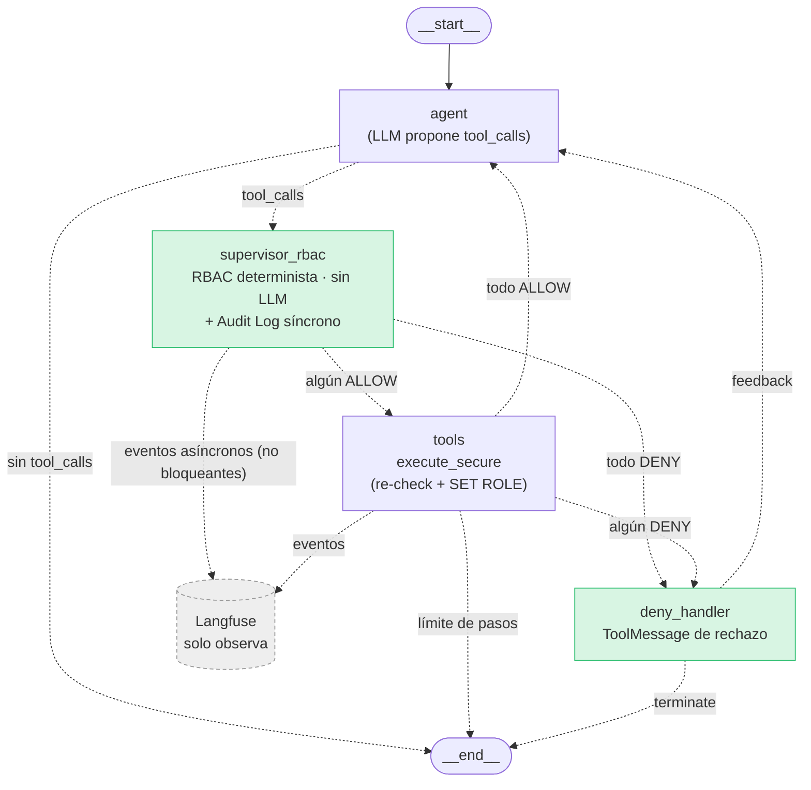

# Arquitectura Secure — LangChain + LangGraph + Supervisor RBAC + Langfuse

> Principio rector: **el LLM propone, el Supervisor RBAC decide, la herramienta ejecuta y Langfuse solo observa.**
> El código descrito existe en el repositorio; cada sección enlaza al archivo que la implementa.

---

## 1. Flujo de datos y frontera de confianza

```
 ZONA CONFIABLE (código propio, determinista)          │ ZONA NO CONFIABLE
                                                       │
 [1] Cliente ──HTTP+JWT──► FastAPI                     │
 [2] FastAPI valida JWT y lee el rol actual en BD      │
     → AuthContext(user_id, username, role) inmutable  │
 [3] FastAPI genera trace_id (32 hex) y crea el estado │
     del grafo {messages, auth, trace_id, ...}         │
 ════════════════════ FRONTERA DE CONFIANZA ═══════════╪══════════════════════
                                                       │ [4] nodo agent: el LLM
                                                       │     recibe los mensajes y
                                                       │     devuelve un AIMessage con
                                                       │     tool_calls PROPUESTAS
                                                       │     (nombre + args JSON)
 ════════════════════ FRONTERA DE CONFIANZA ═══════════╪══════════════════════
 [5] Arista condicional: si hay tool_calls → supervisor_rbac
 [6] supervisor_rbac, por cada tool_call:
      a. emite tool_attempt (structlog + cola Langfuse)
      b. Supervisor.authorize(auth, tool, args)   ← rol del AuthContext, nunca del texto
         deny-by-default · validación de args · condiciones · lockout · fail-closed
      c. INSERT síncrono en audit_log (si falla → DENY-FAILSAFE-003)
      d. emite authz_decision (ALLOW/DENY, rule_id, latencia, tokens)
 [7] Arista condicional: algún ALLOW → tools ; todos DENY → deny_handler
 [8] tools: solo ejecuta las llamadas con ALLOW, a través de services.execute_secure:
      a. re-evalúa la política (barrera 2)
      b. SET LOCAL ROLE agent_<rol> en PostgreSQL (barrera 3)
      c. UPDATE audit_log.executed / execution_status
 [9] deny_handler: ToolMessage de rechazo + respuesta fija → END (DENY_MODE=terminate)
 [10] Langfuse recibe todos los eventos de forma asíncrona (cola + hilo); no participa en [5]–[9]
```

Lo que cruza la frontera desde la zona no confiable es **únicamente** `AIMessage.tool_calls` (nombre y argumentos). El LLM no ve `auth` ni puede escribirlo: el nodo `agent` solo devuelve `{"messages": [...], "steps": n}`, y LangGraph fusiona en el estado únicamente las claves que devuelve cada nodo.

---

## 2. LangChain: herramientas propuestas, no ejecutadas

Implementación: [`app/tools.py`](../app/tools.py), [`app/policy.py`](../app/policy.py).

- Cada herramienta tiene un esquema Pydantic (`QueryCustomersArgs`, `DeleteCustomerArgs`, …) con `extra="forbid"`, tipos, rangos y longitudes. **El mismo esquema** sirve para (a) describir la herramienta al LLM y (b) validar los argumentos en el Supervisor (R4), así que no hay dos fuentes de verdad.
- Las herramientas se crean con `StructuredTool.from_function(func=_not_directly_executable, args_schema=...)` y se enlazan con `ChatOpenAI(...).bind_tools(LC_TOOLS)`. La función asociada lanza una excepción: aunque alguien usara un `ToolNode` o un `AgentExecutor`, LangChain no podría ejecutar nada.
- La llamada propuesta se obtiene leyendo `ai_message.tool_calls` (lista de `{"id", "name", "args"}`) y `ai_message.invalid_tool_calls` (JSON mal formado, que también pasa por el Supervisor y termina en `DENY-ARGS-001`).
- Los argumentos **no** incluyen `user_id` ni `role`. Si el LLM los inyecta, `extra="forbid"` invalida la llamada.

---

## 3. LangGraph: estado, nodos y aristas

Implementación: [`app/agent_secure.py`](../app/agent_secure.py).

### 3.1 Esquema del estado

```python
class AgentState(TypedDict):
    messages: Annotated[list[AnyMessage], add_messages]   # único canal que toca el LLM
    auth: AuthContext            # @dataclass(frozen=True): user_id, username, role — lo pone FastAPI
    trace_id: str                # correlación Audit Log ↔ Langfuse
    steps: int                   # límite de iteraciones del agente
    decisions: list[dict]        # decisiones del último lote de tool_calls
    attempts: Annotated[list[dict], operator.add]          # historial acumulado
    blocked: bool
```

### 3.2 Nodos

| Nodo | Responsabilidad | Usa LLM |
|---|---|---|
| `agent` | Invoca el LLM con el prompt de sistema y el historial; devuelve un `AIMessage` | Sí |
| `supervisor_rbac` | Por cada tool_call: telemetría del intento → `Supervisor.authorize` → Audit Log → telemetría de la decisión | **No** |
| `tools` | Ejecuta **solo** las llamadas con ALLOW vía `execute_secure`; crea `ToolMessage` | No |
| `deny_handler` | Responde a las llamadas denegadas con `ToolMessage` de rechazo y una respuesta final fija | No |

### 3.3 Aristas condicionales

| Origen | Condición | Destino |
|---|---|---|
| `START` | — | `agent` |
| `agent` | hay `tool_calls` o `invalid_tool_calls` | `supervisor_rbac` |
| `agent` | no hay llamadas | `END` |
| `supervisor_rbac` | al menos un ALLOW | `tools` |
| `supervisor_rbac` | todas DENY | `deny_handler` |
| `tools` | hubo algún DENY en el lote | `deny_handler` |
| `tools` | todo ALLOW y `steps < MAX_AGENT_STEPS` | `agent` |
| `deny_handler` | `DENY_MODE=terminate` (por defecto) | `END` |
| `deny_handler` | `DENY_MODE=feedback` y quedan pasos | `agent` |

### 3.4 Diagrama (generado con `graph.get_graph().draw_mermaid()` y anotado)



### 3.5 Por qué la interceptación ocurre en una transición de estado y no dentro de la herramienta

1. **Garantía estructural:** la única arista hacia `tools` sale de `supervisor_rbac`. No hay camino en el grafo desde `agent` hasta `tools` que no pase por la decisión; un control dentro de cada herramienta depende de que cada desarrollador lo recuerde.
2. **Decisión antes de efectos:** el Supervisor decide sobre la *propuesta* (nombre + args) antes de abrir una conexión o una transacción, de modo que no queda ningún efecto parcial que revertir.
3. **Registro uniforme:** todos los intentos, incluidos los de herramientas inexistentes o mal formadas, pasan por un único punto que escribe el Audit Log. Una herramienta que no existe no podría registrar su propio rechazo.
4. **Separación de responsabilidades:** las herramientas implementan lógica de negocio y el Supervisor implementa la política. Cambiar la política no exige tocar las herramientas.
5. **Defensa en profundidad (R5):** de todos modos, `execute_secure` vuelve a evaluar la política dentro de la herramienta, y PostgreSQL aplica privilegios por rol. El nodo del grafo es la **primera** barrera, no la única.

---

## 4. Comportamiento tras DENY

| Criterio | (a) ToolMessage de rechazo al LLM y continuar | (b) Terminar el flujo |
|---|---|---|
| Experiencia de usuario | El LLM puede explicar el rechazo o proponer una alternativa legítima | Respuesta fija y determinista |
| Riesgo de reintentos | **Alto:** el modelo puede reformular, cambiar argumentos o probar otra herramienta (sondeo de la política dentro de una misma petición) | **Nulo** dentro de la petición: el LLM no vuelve a ser invocado |
| Consumo de tokens | Crece con cada reintento (LLM10) | Acotado: una sola invocación |
| Fuga de información de la política | El LLM ve `rule_id` y `reason`, y puede usarlos para ajustar el ataque | El usuario ve el `rule_id`; el modelo no recibe una nueva oportunidad |
| Trazabilidad | Varias decisiones por traza | Una decisión clara por traza |

**Recomendación: (b) terminar el flujo** (`DENY_MODE=terminate`, valor por defecto). Aun así, para mantener un historial válido para la API del LLM, `deny_handler` añade un `ToolMessage` de rechazo por cada `tool_call_id` antes del mensaje final. El modo (a) existe (`DENY_MODE=feedback`) para el experimento comparativo; en ese modo el `LockoutTracker` (K=3) acota los reintentos, como verifica `test_feedback_mode_retries_are_bounded_by_lockout`.

---

## 5. Langfuse: solo observabilidad

Implementación: [`app/telemetry.py`](../app/telemetry.py).

**SDK asumido: `langfuse==3.15.0`** (v3, basado en OpenTelemetry).

### 5.1 Qué se registra por intento de herramienta

| Qué | Cómo (API v3) | Campos |
|---|---|---|
| Traza raíz | `start_span(trace_context={"trace_id": tid}, name="agent_request")` + `span.update_trace(name, user_id, session_id, tags, metadata)` | `architecture`, `user_role`, `user_id`, `message` |
| (c) Tokens | `langfuse.langchain.CallbackHandler(trace_context={"trace_id": tid})` en `config["callbacks"]` del grafo → cada llamada al LLM queda como *generation* con `usage` | `input`, `output`, `total` tokens, modelo |
| (a) Intento | `create_event(trace_context=..., name="tool_attempt:<tool>")` | `tool_name`, `tool_args`, `tool_call_id`, `user_role`, `user_id`, `prompt_tokens`, `completion_tokens`, `total_tokens` |
| (b) Decisión | `create_event(name="authz_decision:<ALLOW/DENY>", level=WARNING si DENY)` | `decision`, `rule_id`, `reason`, `policy_version`, `authz_latency_ms`, `tool_call_id` |
| Ejecución | `create_event(name="tool_execution:<tool>")` | `status` (`ok`/`error`), `error` |
| Alerta (detección) | `create_event(name="security_alert:<tipo>", level=ERROR)` | `alert`, `user_id`, `rule_id` |

Los tokens también se guardan en `audit_log` (`prompt_tokens`, `completion_tokens`, `total_tokens`), tomados de `AIMessage.usage_metadata` del paso del LLM que propuso la llamada. Así la métrica no depende de Langfuse.

### 5.2 Telemetría no bloqueante (R6)

`Telemetry._emit` hace `queue.put_nowait` dentro de un `try/except`. Si la cola está llena o falla cualquier cosa, el evento se descarta (`telemetry.dropped += 1`). Un hilo *daemon* consume la cola y envía a Langfuse, y además el exportador OTel del SDK agrupa los envíos en segundo plano. **Ningún valor que devuelve Langfuse se lee en la ruta de decisión.** La prueba `test_telemetry_outage_does_not_change_decisions` simula una caída de Langfuse y verifica que las decisiones no cambian.

### 5.3 Esquema de correlación

```
trace_id = uuid4().hex   (32 hex, generado por la app en FastAPI)
   ├── audit_log.trace_id          (PostgreSQL, fuente de verdad)
   ├── Langfuse trace.id           (trace_context={"trace_id": trace_id})
   ├── structlog campo trace_id    (logs/app.jsonl)
   └── respuesta HTTP /api/chat    (el cliente la puede citar)
tool_call_id (id generado por el proveedor del LLM) une, dentro de la traza: tool_attempt ↔ authz_decision ↔ tool_execution ↔ fila de audit_log
```

Consulta de ejemplo: `SELECT * FROM audit_log WHERE trace_id = '<id>'` y, en Langfuse, `/project/<pid>/traces/<id>`. La API devuelve esa URL en `langfuse_url`.

### 5.4 Si se usa otra versión del SDK

| Aspecto | v3 (asumida) | v2 |
|---|---|---|
| Cliente | `Langfuse()` / `get_client()` | `Langfuse()` |
| Handler LangChain | `from langfuse.langchain import CallbackHandler`; `CallbackHandler(trace_context=...)` | `from langfuse.callback import CallbackHandler`; `CallbackHandler(trace_id=..., user_id=...)` |
| Traza con ID propio | `trace_context={"trace_id": ...}` (debe ser 32 hex) | `langfuse.trace(id=...)` (cualquier string) |
| Eventos | `create_event(...)`, `start_span(...)` | `trace.event(...)`, `trace.span(...)` |
| Atributos de traza | `span.update_trace(...)` | `trace.update(...)` |
| Envío | Exportador OTel en lote | Cola propia del SDK |

Todo uso del SDK está concentrado en `app/telemetry.py`, así que migrar de versión solo toca ese archivo.

**Nota sobre Langfuse Cloud v4 (servidor):** con SDKs de Python anteriores a 4.7, los datos pueden tardar hasta 15 min en aparecer en la API v2 de observaciones. Por eso el cliente se crea con `Langfuse(additional_headers={"x-langfuse-ingestion-version": "4"})`; con esa cabecera los datos son consultables en ~10–15 s. La medición de cobertura usa `GET /api/public/v2/observations` (ventana de tiempo + `fields=core,basic,usage,metadata` + paginación por cursor).

---

## 6. Pseudocódigo del nodo `supervisor_rbac`

(Versión simplificada de `app/agent_secure.py` + `app/supervisor.py`)

```python
def supervisor_rbac(state: AgentState) -> dict:
    auth: AuthContext = state["auth"]                 # identidad confiable (R1), nunca del LLM
    ai: AIMessage = state["messages"][-1]
    decisions = []
    for call in ai.tool_calls + ai.invalid_tool_calls:
        telemetry.tool_attempt(state["trace_id"], tool_name=call.name, tool_args=call.args, ...)  # async (R6)

        # ---------------- Supervisor.authorize: determinista, en memoria ----------------
        t0 = perf_counter()
        try:
            if not isinstance(auth, AuthContext):        result = DENY("DENY-AUTH-001")
            elif lockout.is_locked(auth.user_id):        result = DENY("DENY-RATE-001")     # T05
            else:                                         result = engine.evaluate(auth.role, call.name, call.args)
                # engine.evaluate:
                #   tool no registrada            -> DENY-TOOL-001       (R2 deny-by-default)
                #   tool en forbidden_tools       -> DENY-FORBIDDEN-001
                #   rol no definido               -> DENY-ROLE-001       (R2)
                #   rol sin regla para la tool    -> DENY-RBAC-001       (R2)
                #   args no cumplen esquema       -> DENY-ARGS-001       (R4)
                #   condición de negocio falla    -> DENY-COND-001       (R4)
                #   en otro caso                  -> ALLOW(rule_id de la regla)
            if not valid(result):                         result = DENY("DENY-FAILSAFE-001") # R3
        except Exception:
            result = DENY("DENY-FAILSAFE-001")                                               # R3
        latency_ms = (perf_counter() - t0) * 1000
        if result.allowed and latency_ms > AUTHZ_TIMEOUT_MS:
            result = DENY("DENY-FAILSAFE-002")                                               # R3/R7
        if result.denied:
            lockout.register_deny(auth.user_id)       # K=3 en 300 s → bloqueo 600 s
        # -------------------------------------------------------------------------------

        try:
            audit_id = audit.record_decision(trace_id, auth, call, result, latency_ms, tokens)  # síncrono
        except Exception:
            result, audit_id = DENY("DENY-FAILSAFE-003"), None   # sin evidencia no hay ejecución

        telemetry.authz_decision(trace_id, decision=result.decision, rule_id=result.rule_id, ...)  # async
        decisions.append({...call, **result, "audit_id": audit_id})
    return {"decisions": decisions, "attempts": decisions}     # NO devuelve 'auth' (inmutable)
```

---

## 7. Defensa en profundidad (R5)

Omitir el nodo `supervisor_rbac` (por un bug en las aristas, otro endpoint o una llamada directa a la capa de servicios) **no** permite ejecutar la acción:

| Barrera | Dónde | Qué hace | Evidencia |
|---|---|---|---|
| 1 | `supervisor_rbac` (LangGraph) | Decide antes de ejecutar y registra | `tests/test_graph.py` |
| 2 | `services.execute_secure` | Vuelve a llamar a `PolicyEngine.evaluate(auth.role, …)` con la identidad autenticada | `test_service_rechecks_policy_without_graph`; `POST /api/tools/delete_customer` como Support → 403 `DENY-RBAC-001` |
| 3 | PostgreSQL | `SET LOCAL ROLE agent_support`/`agent_admin`: privilegios por rol (Support sin `DELETE`/`UPDATE` ni `SELECT document_id`; nadie con `UPDATE app_users`) | `test_postgres_role_blocks_even_if_app_checks_are_bypassed` → `InsufficientPrivilege` |
| Oráculo | Trigger `log_row_change` | Registra todo `UPDATE`/`DELETE` con el rol de BD efectivo, independientemente de la app | `db_change_log` |

---

## 8. Análisis de latencia (R7)

### 8.1 Cuellos de botella identificados

| Componente | Riesgo | Decisión de diseño |
|---|---|---|
| RBAC en memoria vs consulta a PostgreSQL | Consultar permisos en BD añade un viaje de red y contención del pool | La política se carga **una vez** desde `policy.yaml` a diccionarios (O(1) por rol y herramienta). No hay I/O en `authorize()` |
| Caché de políticas | Recargar YAML en cada petición cuesta milisegundos | Caché en memoria durante el proceso; un cambio de política exige reiniciar o recargar de forma explícita y cambia `policy_version` |
| Validación Pydantic | Esquemas complejos | Esquemas planos; Pydantic v2 (núcleo en Rust) |
| Escritura del Audit Log | Un INSERT síncrono es la parte más cara | Una sola sentencia por intento usando el pool de conexiones; se mide aparte |
| Overhead de callbacks | El `CallbackHandler` de Langfuse y los eventos | Fuera de la ruta de decisión: los eventos se encolan (`put_nowait`, microsegundos) y la red la usa otro hilo |
| Serialización | `json.dumps` de argumentos y metadatos | Solo en el INSERT y en el hilo de telemetría |
| Lockout | Lock compartido entre hilos | Sección crítica de unas pocas operaciones sobre un `deque` |

### 8.2 Presupuesto por componente (p95) frente a lo medido

Medición: `python scripts/bench_authz.py --n 10000 --n-audit 1000` (Windows 11, Python 3.11, PostgreSQL 16 en Docker local), mezclando roles, herramientas y argumentos inválidos. Resultado en `reports/b01_latency.json`.

| Componente | Presupuesto p95 | Medido |
|---|---|---|
| Extracción de `tool_calls` del AIMessage | 1 ms | despreciable (acceso a lista) |
| `Supervisor.authorize` (lockout + política + Pydantic + condiciones) | 5 ms | **p50 0.0026 ms · p95 0.0070 ms · p99 0.0137 ms** (n=10 000) |
| INSERT síncrono en `audit_log` | 25 ms | incluido en la fila siguiente |
| **authorize + INSERT audit (ruta completa antes de ejecutar)** | **≤ 40 ms** | **p50 2.76 ms · p95 5.39 ms · p99 6.54 ms** (n=1 000) |
| Encolado de telemetría (×2 eventos) | 1 ms | microsegundos (`put_nowait`) |
| Margen | 9 ms | — |
| **Total** | **< 50 ms** | **≈ 5.4 ms en p95** |

La latencia del LLM (segundos) **no** forma parte del presupuesto de autorización: ocurre antes de que exista una propuesta que autorizar. El Supervisor aplica además un **timeout de 50 ms** (`AUTHZ_TIMEOUT_MS`): si una decisión ALLOW se tarda más, se convierte en `DENY-FAILSAFE-002` (fail-closed).

---

## 9. Matriz de trazabilidad de requisitos

| Requisito | Componente que lo implementa | Verificación |
|---|---|---|
| R1 Identidad confiable | `auth.get_auth_context` (JWT HS256 + rol leído de `app_users`), `identity.AuthContext` (frozen), estado `auth` que ningún nodo devuelve, esquemas con `extra="forbid"` | `test_llm_cannot_inject_identity_through_args` |
| R2 Deny-by-default | `PolicyEngine.evaluate` (`DENY-TOOL-001`, `DENY-ROLE-001`, `DENY-RBAC-001`); el constructor rechaza políticas con `default_decision != DENY` | `test_policy.py::test_matrix`, `test_unknown_role_denied`, `test_unknown_tool_denied`, `test_policy_must_be_deny_by_default` |
| R3 Fail-closed | `Supervisor.authorize` (`DENY-FAILSAFE-001/002`), `supervisor_rbac` (`DENY-FAILSAFE-003` si falla el Audit Log) | `test_fail_closed_on_exception`, `…_invalid_result`, `…_timeout`, `test_audit_failure_is_fail_closed` |
| R4 Validación de argumentos | `TOOL_SCHEMAS` (Pydantic), condiciones de `policy.yaml` (`abs_lte`, …) | `test_invalid_args_denied`, `test_business_condition` |
| R5 Defensa en profundidad | `services.execute_secure` (re-check + `SET LOCAL ROLE`), `GRANT` por rol en `db/01_schema.sql`, endpoint `/api/tools/{tool}` | `tests/test_defense_in_depth.py` |
| R6 Telemetría no bloqueante | `telemetry.Telemetry` (cola + hilo, `try/except`), sin lecturas de Langfuse en la ruta de decisión | `test_telemetry_outage_does_not_change_decisions` |
| R7 Latencia p95 < 50 ms | Política en memoria, `AUTHZ_TIMEOUT_MS`, INSERT único | `test_latency_budget`, `scripts/bench_authz.py` (B01) |

---

## 10. Supuestos que el equipo debe validar

1. Roles y permisos según el contexto común; `modify_balance` para Admin se limitó a `|amount| ≤ 5000` (condición de ejemplo, ajustable en `policy.yaml`).
2. Umbral T05: K=3 DENY en W=300 s → bloqueo de L=600 s, en memoria (un solo proceso). Con varias réplicas habría que moverlo a Redis.
3. Tras DENY se termina el flujo (`DENY_MODE=terminate`).
4. El rol se lee de la BD en cada petición (el JWT solo identifica al usuario). Así un cambio de rol se aplica de inmediato.
5. Langfuse Cloud con SDK v3.15; el `trace_id` lo genera la aplicación.
6. El mismo prompt de sistema en Unsecure y Secure, sin restricciones de rol en lenguaje natural. Es deliberado: demuestra que la seguridad **no** depende de las instrucciones al modelo.
7. LLM: `qwen2.5:7b` local vía Ollama (API compatible con OpenAI, `ChatOpenAI(base_url=...)`), `temperature=0`. Se cambia a OpenAI con `LLM_PROVIDER=openai` sin tocar el código.
8. Autenticación de demostración (usuarios semilla, JWT HS256 con secreto en `.env`); en producción se usaría un IdP (OIDC).
9. El Audit Log vive en la misma instancia de PostgreSQL que los datos de negocio, pero en otra tabla. En producción convendría un almacén *append-only* separado.
